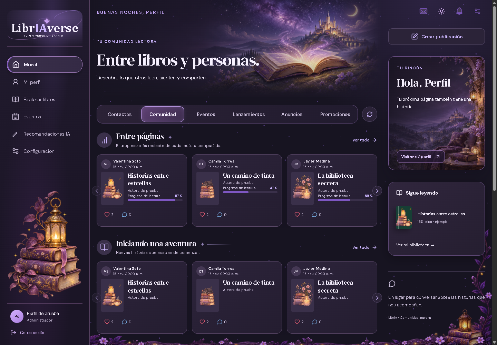

# Prueba de borde inferior: Reino de Sombras

Registro de la prueba original de `dark`. Tras la aprobación del usuario, el acabado se extendió a todos los temas; ver [implementación general](footers-ilustrados-todos-los-temas.md).

Versión activa: `apps/web/public/images/theme-refresh-v1/dark/footer-v2.webp` (1800×600, 91 KB, transparencia real). Borde inferior más delgado, color violeta más intenso y rama completa dentro del lienzo. La primera versión permanece conservada. Generada/editada con la herramienta integrada siguiendo imagegen; prompts en `artifacts/footer-preview-prompt.json` y `artifacts/footer-preview-v2-prompt.json`. Original seleccionado en `artifacts/theme-generation/originals/refresh-dark/footer-v2.png`.

`ThemeFooterPreview.css` la integra detrás del contenido, al fondo del área fija. Se retiró la máscara superior para no desvanecer la rama; usa opacidad 78 % en escritorio y 72 % en celular. La imagen rebasa unos píxeles los límites inferior y laterales del fondo recortado para ocultar los márgenes transparentes del lienzo y eliminar la separación visual. Su área de pintura en escritorio abarca el fondo completo para no recortar la parte alta. Mantiene el alto de la ventana y los controles del fondo mágico. No modifica los otros 23 temas.

[Captura de celular](../artifacts/footer-preview-v3/dark-390-mural.png).

Validación: nueve vistas y siete resoluciones en Chrome/CDP, sin excepciones ni desbordamiento, fondo fijo y contenido desplazable. Compilación correcta con advertencia existente de tamaño del bundle. Registro: `artifacts/footer-preview-validation.log`. Sin commit.
